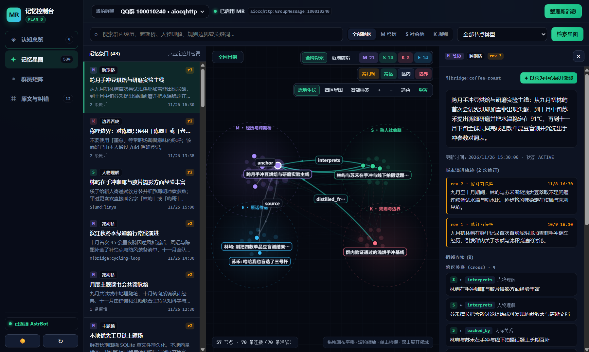
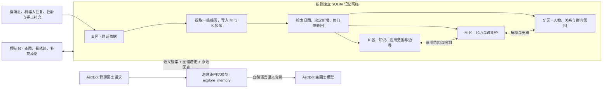
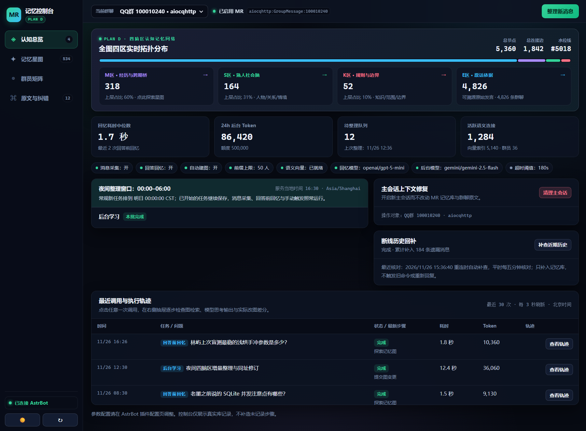

<div align="center">

# MR Memory · 群聊认知记忆

**为 AstrBot 保存群聊经历，在回答前找回相关原话、人物线索与旧事背景**

[](https://github.com/AstrBotDevs/AstrBot)
[](#数据存储与迁移)
[](#内置管理控制台)

[核心能力](#核心能力) · [四区网络架构](#四区记忆网络架构) · [控制台预览](#内置管理控制台) · [快速启用](#快速启用) · [配置参考](#核心配置参考) · [群聊指令](#群聊指令) · [协议与向量](#模型接口与本地向量) · [平台迁移](#数据存储与迁移)

</div>

---

MR Memory 按群保存聊天原文。群友提起旧事时，记忆模型可以查原话、找相关经历，把有用的背景交给 AstrBot 原有的主回复模型。

新群从第一条采集的发言开始建立 **Plan D 四区网络**。原话先进入 E 区，后续整理由此生成人物理解、经历与边界。打开「认知总览」可查看群库使用的引擎：新群和已迁入四区的群显示 `PLAN D`，升级前已有的基础库继续使用 `LEGACY`。

<p align="center">
  
</p>
<p align="center">
  <sub>内置控制台「记忆星图」工作台：四脑区轨道分布、跨月捷径与右侧节点修订轨迹（示例使用合成测试数据渲染）</sub>
</p>

## 核心能力

- **四区记忆网络（E / M / S / K）**：区分原话、经历、人物理解与规则边界。新材料可以形成新节点，也可以在旧地址修订或撤回已有认识。控制台可查看已记录的节点版本。
- **回答前主动回忆**：四区引擎先按当前问题、在场人物和近期记忆定位图中入口。记忆模型可直接交付背景，也可调用 `explore_memory` 阅读节点、展开邻边、查找人物或重新做语义搜索。
- **后台增量整理**：默认在服务当地时间 `00:00–06:00` 启动常规任务。四区引擎先按批把待处理原话提炼为一级经历，再拿这批经历检索旧认识，决定是否增加节点、同址修订或连接跨月经历。每群单独计算滚动 24 小时后台 Token 预算，已完成批次可从检查点续接。
- **内置可观测控制台**：直接注册为 AstrBot Plugin Page（`console`），复用 AstrBot 鉴权与 Web 服务；提供认知总览、交互式四区记忆星图、调用轨迹瀑布、群员资料管理、平台迁移与管理员纠错投喂台。
- **断线历史回补与平台接续**：OneBot 群聊在启动、重连及定时核对时，可补录 NapCat 仍能返回的历史，按群和消息 ID 去重。补录本身不调用 LLM，也不会重放旧命令。官方 QQ 群可接续已有旧群库。

## 四区记忆网络架构



| 脑区 | 职责定位 | 典型节点类型 | 溯源与演化方式 |
| --- | --- | --- | --- |
| **E · 原话依据** | 保存群友发言、机器人回复和管理员补充，并记录可解析的引用 | `message` | 按地址回查原话、作者与时间；同一消息的修订及个人遗忘请求会影响可读内容 |
| **M · 经历与跨期桥** | 将发言提炼为一级经历，并连接跨期事件或共同主题 | `episode`、`event`、`semantic`、`bridge`、`field` | 一级经历通过 `source` 指回原话。活跃桥引用新旧跨月经历时，系统可在两者间投影捷径 |
| **S · 熟人社会脑** | 持续形成对群员个体、人际关系、熟悉度与群内氛围的理解 | `observation`、`understanding`、`relationship`、`situated_knowledge`、`atmosphere`、`familiarity` | 同址更新并保存 `history` 修订版本链 |
| **K · 规则与边界** | 记录知识、适用情境与纠偏边界 | `content`、`scope`、`veto` | 除这些上层节点外，K 区还保留一级经历的镜像。可沿 `same_l1` 到 M 地址，或沿 `witness` 回查上层节点的依据 |

## 内置管理控制台

在 AstrBot 插件管理页打开本插件的 **console** 页面，即可在四个工作区中实时观测与维护各群记忆：

- **认知总览**：查看当前群的记忆规模、回忆耗时中位数、24 小时后台 Token 消耗、待整理队列与夜间窗口状态，也可管理断线历史回补与主会话上下文修复。点开一次调用，可核对其已记录的检索、耗时、交付背景或写图差分。
- **记忆星图**：基于 Canvas 的交互式图谱工作台，支持「四区星图 / 力导布局」与「全网骨架 / 近期前沿」切换、按脑区和类型检索、左栏分页浏览、双击节点原地生长或单点聚焦，以及右侧节点详情（正文、历史修订轨迹、分组邻边与原话上下文直达）。
- **群员矩阵与平台迁移**：查看固定前缀活跃成员配额、编辑成员称呼/别名/禁用称呼/说明，以及从 NapCat 到官方 QQ 的群库接续与跨账号匹配。
- **原文与纠错**：按群浏览完整原文流与上下文，并通过「管理员纠错投喂台」提交仅写入本群记忆库、不向群内发送的补充说明（带幂等提交编号，支持排入下次窗口或立即整理，并回显整理后的图谱变更回执）。

<details>
<summary>展开查看「认知总览与调用轨迹」预览图</summary>

<p align="center">
  
</p>

</details>

## 快速启用

### 环境要求

- **AstrBot**：`>= 4.27.1`，请使用该版本 AstrBot 支持的 Python 环境。
- **Python 依赖**：见 [`requirements.txt`](requirements.txt)（`sentence-transformers>=5.2,<6`、`numpy>=1.26,<3`）

### 安装与开启

1. 在 AstrBot 插件管理中通过本仓库 URL 安装 `astrbot_plugin_mr_memory`，等待依赖安装完成并加载插件。
2. 在插件配置页选择群和记忆模型：
   - 打开 `capture_enabled`，并在 `allowed_umos` 中填写要启用的群会话（留空则对所有群生效）。
   - 将 `subconscious_provider_id` 设为已配置的对话模型 Provider（需支持原生函数调用）。
   - 如需将前台回忆与后台整理拆分为不同模型，可单独指定 `local_serving_reader_provider_id`（留空则沿用后台模型）。AstrBot 原有的群回复模型保持不变。
3. 在插件管理页打开 **console**，选择对应群聊确认已收到原话。触发一次群聊模型回复后，在「认知总览 → 最近调用与执行轨迹」中可以看到这次回忆读了什么、向主模型交付了什么。

## 核心配置参考

配置页公开 35 项，其中 34 项参与当前运行，1 项保留旧配置值。另有 5 项隐藏的旧反馈学习字段。字段名和默认值见 [`_conf_schema.json`](_conf_schema.json)。

### 采集、回补与成员前缀

| 配置项 | 默认值 | 说明 |
| --- | --- | --- |
| `capture_enabled` | `false` | 开启后记录群聊发言、机器人实际回复与工具活动 |
| `allowed_umos` | `[]` | 启用的群会话列表；留空表示允许全部群聊 |
| `history_recovery_enabled` | `true` | OneBot 群聊在启动、重连及每 5 分钟自动补查遗漏历史，去重入库且不触发旧回复 |
| `history_recovery_initial_hours` | `24` | 首次启用或手动补查近期历史的回溯时长（小时） |
| `member_prefix_capacity` | `50` | 固定前缀最多携带的近 7 天活跃群员数；`0` 关闭固定前缀（仍可检索全员，不限制资料存储） |

### 回答前主动回忆

| 配置项 | 默认值 | 说明 |
| --- | --- | --- |
| `local_serving_enabled` | `true` | 开启回答前潜意识回忆，向 AstrBot 主回复模型注入语义背景 |
| `local_serving_reader_provider_id` | `""` | 独立指定回答前记忆模型；留空沿用 `subconscious_provider_id` |
| `local_serving_reader_thinking_mode` | `"disabled"` | 前台思考模式（`disabled` / `enabled`，直连 DeepSeek 时生效） |
| `max_loop_steps` | `6` | 回答前记忆模型最多调用轮数，包含最后的正文交付轮；一轮可以发出多个工具调用 |
| `memory_max_tokens` | `8192` | 回答前单轮记忆模型输出 Token 上限 |
| `recent_messages` | `24` | 为本轮回忆准备的近期群消息条数；更早材料可另行检索 |
| `local_serving_max_chars` | `12000` | 注入给主回复模型的语义背景字符上限 |
| `local_serving_timeout_seconds` | `180` | 回答前调用的异常兜底超时（秒） |

### 后台两阶段整理与预算

| 配置项 | 默认值 | 说明 |
| --- | --- | --- |
| `subconscious_enabled` | `true` | 后台记忆整理总开关（与回答前检索相互独立） |
| `subconscious_provider_id` | `"deepseek/deepseek-v4-flash"` | 后台整理所用的 AstrBot 对话模型 Provider |
| `auto_distillation_enabled` | `true` | 按窗口与阈值自动触发后台增量整理 |
| `learning_window_enabled` | `true` | 优先在指定本地时段执行常规后台整理（手动触发与前台回忆不受限制） |
| `learning_window_start` / `learning_window_end` | `"00:00"` / `"06:00"` | 后台工作时段（`HH:MM`，跟随服务进程本地时区，支持跨午夜） |
| `auto_distillation_min_pending` | `150` | 单群待处理消息达到该条数即满足积累条件，执行仍受工作时段与额度限制 |
| `maintenance_interval_seconds` | `86400` | 消息不足条数时，从最早待处理消息算起，达到此秒数也满足积累条件 |
| `background_interval_seconds` | `60` | 后台检查待处理工作与索引的间隔（秒） |
| `distillation_max_messages` | `80` | 每批最多整理的待处理消息数 |
| `distillation_max_output_tokens` | `384000` | 后台单次输出 Token 上限；四区整理还按提取或整合阶段的材料量缩小单次请求值 |
| `distillation_thinking_mode` | `"enabled"` | 后台整理思考模式（直连 DeepSeek 时生效） |
| `maintenance_llm_timeout_seconds` | `3600` | 后台模型调用的异常超时（秒） |
| `private_daily_token_budget` | `500000` | 每群滚动 24 小时后台整理 Token 额度；`0` 表示不限 |
| `advanced_memory_enabled` | `false` | 旧配置兼容项。改动此值不会启动已移除的高级反思或反馈学习，也不会启用四区网络 |

### 本地语义检索

| 配置项 | 默认值 | 说明 |
| --- | --- | --- |
| `embedding_enabled` | `true` | 启用语义向量。基础库关闭后仍可按原文、成员或关系查询；四区库的前台回忆和后台整理均要求开启 |
| `embedding_provider_id` | `""` | 留空由 MR 独立加载；填写共享本地向量插件 Provider ID 后复用同一模型实例 |
| `embedding_model_name` | `"BAAI/bge-small-zh-v1.5"` | 本地 Sentence Transformers 向量模型名称 |
| `embedding_query_prompt_name` | `"auto"` | 查询提示名；`auto` 会为 Harrier 自动选择 `web_search_query`，其余模型不附加提示 |
| `embedding_cpu_threads` / `embedding_batch_size` / `embedding_max_seq_length` | `1` / `16` / `512` | 本地向量推理线程数、批大小与最大输入长度 |

## 群聊指令

| 指令 | 作用 | 示例 |
| --- | --- | --- |
| `/uid` 或 `/mr uid` | 查看或修改本人在本群的称呼、别名、不用的称呼与个人说明（填 `-` 清空对应项） | `/uid 称呼 林屿 别名 屿哥 不用 墨总 说明 周末常约手冲` |
| `/uid qqid <QQ号>` | 在已接续的官方 QQ 群自愿关联旧 QQ 号；填 `-` 取消本人关联 | `/uid qqid 你的QQ号` / `/uid qqid -` |
| `/mrmem` | 查看插件本次加载以来该群最近一次前台回忆状态，以及滚动 24 小时用量与预算 | `/mrmem` |
| `/mrforget` | 清除本人在本群已记录的发言正文与成员资料，使相关记忆失效，并停止采集本人的后续发言 | `/mrforget` |

## 模型接口与本地向量

### 支持的模型协议

选择支持**原生函数调用**的回忆模型。基础库的后台整理也使用函数工具，四区库的两阶段整理则要求模型返回可解析的 JSON。前后台可分别选择使用以下协议的 AstrBot 提供商：

- **OpenAI Chat Completions**
- **OpenAI Responses**
- **Google Gemini**（使用所选 Provider 的原生适配，显式结束工具调用的轮次会移除工具）
- **Anthropic Messages**

直连 DeepSeek 时可分别配置前后台思考模式。其他自定义 AstrBot Provider 的 `text_chat` 需显式支持 `func_tool` 及逐轮输出上限参数，后台 JSON 交付还需支持 `response_format`。所选模型也须接受相应请求。

### 独立向量与共享向量

- 默认由 MR 独立在本地缓存目录加载 Sentence Transformers 模型进行语义检索。
- 若同时运行多个需要本地向量的插件，可在 `embedding_provider_id` 中填写共享本地向量插件的 Provider ID 以复用同一推理实例。接入时须保持模型名、查询提示与最大输入长度和现有索引一致；共享服务不可用时会明确报错，不会静默切换模型。
- 四区库在首次使用向量时绑定编码器提供的模型标识和输出维度。默认 BGE 或配置的其他本地、共享向量模型都可用于新群。已有索引继续使用建库时的向量空间；即便维度相同，不同模型的向量也不能混用。

## 数据存储与迁移

### 存储与升级

- 各群数据独立保存在 `<astrbot_data>/plugin_data/astrbot_plugin_mr_memory/scopes/<scope_hash>.db`。
- 跨平台群与成员身份映射保存在 `platform_bindings.json`。
- 升级时保留整个插件数据目录，并沿用与索引匹配的向量配置。插件热重载会等待正在进行的前台回忆结束，再关闭数据库连接。

### 从 NapCat（OneBot）接续到官方 QQ

1. 将官方 QQ 机器人拉入原群并开启全部群消息权限，待新群收到消息后在控制台选定该群。
2. 打开 **群员矩阵 → 平台迁移**，选择对应的旧 QQ 群，预览匹配后执行接续。请在新端开始独立整理之前操作。新端已有独立的上层记忆或未完成整理任务时，接续会报错。
3. 接续后，新端消息写入旧群原有数据库，继续使用其中的记忆、向量与整理进度。绑定前新端采集的未删除原话也会导入。官方 QQ 只能记录在线收到的发言，平台不提供 OneBot 的断线历史回补接口。
4. 群名片或昵称唯一一致的成员自动关联，其余成员可由管理员在控制台手工匹配，或由群员使用 `/uid qqid <QQ号>` 自愿关联（管理员设定优先）。身份映射不改写历史原文作者与时间，也不会转移 AstrBot 管理员权限。

<details>
<summary>开发者扩展：可选消息语境接口（面向角色扮演等第三方插件）</summary>

第三方插件无需导入 MR，也不必安装额外兼容插件，即可在消息事件上声明结构化语境，帮助 MR 区分平台发送账号与实际发言角色：

- **输入语境**：在事件上写入 `event._mr_input_context` 字典，可包含 `version=1`、`producer`、`mode` 及适用的 `speaker`、`addressed_to`、`session_id`、`turn_id`、`utterance_id` 等字段。若在采集后补充，先确认事件提供了 `_mr_update_input_context` 回调，再调用并等待其完成。
- **输出语境**：在发送作用域内设置 `event._mr_output_context`，发送结束后恢复。
- MR 将该字典作为 `message_context` 段保存在原消息内容中，平台账号仍是发送者。在基础图里回查原话时，可以同时看到生产方提供的语境。四区整理读取正文、作者、角色、时间、提及和引用，当前不会把第三方语境字典完整送入整理模型。

</details>

## 仓库结构

```text
astrbot_plugin_mr_memory/
├── main.py                  # AstrBot 插件入口、消息捕获、钩子注入、后台调度与群聊指令
├── metadata.yaml            # AstrBot 插件元数据声明
├── _conf_schema.json        # 插件配置项定义与默认值
├── requirements.txt         # Python 依赖声明
├── mr_memory/
│   ├── agent.py             # 记忆代理编排、预算估算与断点续接
│   ├── console.py           # 控制台认证 Web API（20 个群级/全局路由）
│   ├── manual_messages.py   # 管理员纠错投喂、幂等回执与图谱差分记录
│   ├── store.py             # SQLite 持久化、原文/成员/额度账本与遗忘接口
│   ├── history.py           # OneBot 断线历史自动回补
│   ├── identity.py          # 跨平台群与成员身份绑定
│   ├── provider_transport.py # OpenAI / Gemini / Anthropic 原生协议适配
│   ├── embedding.py         # 本地 Sentence Transformers 向量编码器
│   ├── shared_embedding.py  # 共享本地向量 Provider 适配层
│   └── network/             # 四区记忆网络核心（图谱存储、两阶段整理、主动回忆、控制台视图）
├── pages/console/           # 内置 Web 控制台前端（HTML / CSS / Canvas 星图 / 轨迹瀑布）
├── assets/                  # GitHub 页面使用的合成控制台截图
└── tests/                   # 单元测试与合约测试
```
